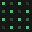

<p align="center">
  
</p>

<h1 align="center">TOKENMAXX</h1>

<p align="center">
  <strong>The leaderboard for using the most tokens.</strong><br />
  Connect every AI coding subscription. Climb hourly · daily · weekly · monthly.
</p>

<p align="center">
  <a href="https://tokenmaxx-six.vercel.app">Live</a> ·
  <a href="#run-locally">Run locally</a> ·
  <a href="CONTRIBUTING.md">Contribute</a> ·
  <a href="LICENSE">MIT</a>
</p>

---

## Why

Everyone optimizes for fewer tokens. TOKENMAXX is the opposite sport: wire up Cursor, Claude Code, Codex, Gemini, Windsurf, APIs, agents, CLIs — or **T3 Code linkup** for all via-T3 sources in one shot — and compete on raw burn.

## Features

- **54+ providers** across hubs, IDEs, subscriptions, APIs, agents, and CLIs
- **T3 Code linkup** — one connect autoconnects every `viaT3` source
- **Leaderboards** — hourly · daily · weekly · monthly windows
- **Claim a handle** — show up on the board as yourself
- **[dither-kit](https://tripwire.sh/dither-kit)** charts, avatars, and gradient washes
- Clean minimalist brand system (mark · wordmark · OG · icons)

> Demo mode simulates usage sync. Real provider OAuth adapters are welcome as PRs.

## Stack

Next.js (App Router) · TypeScript · Tailwind · dither-kit · Vercel

## Run locally

```bash
npm install
npm run dev
```

Open [http://localhost:3000](http://localhost:3000).

Optional env: copy `.env.example` → `.env.local`.

## Deploy

```bash
npx vercel --prod
```

On Vercel the leaderboard uses an in-memory store (fine for demos). For durable multi-user state, plug in Redis / a DB and keep the same API shapes in `src/app/api/*`.

## Project layout

```
src/
  app/           # routes, OG image, icons
  components/    # UI + dither-kit wrappers
  lib/           # providers, store, site config
public/brand/    # logo mark
```

## License

[MIT](LICENSE) — fork it, maxx it, ship your own league.
